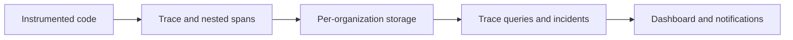

# AgentTrace

Tracing for AI workflows across async code and background job queues.

`Python` `FastAPI` `PostgreSQL` `SQLAlchemy` `Celery` `React`

> One of four projects on running AI agents safely: [AgentHub](https://github.com/asquitt/agent-hub) · [AgentGuard](https://github.com/asquitt/agent-guard) · **AgentTrace** · [SynthArena](https://github.com/asquitt/synth-arena)

## Overview

An AI agent's work rarely happens in one function. A single request can fan out into nested model calls, background jobs, retries, and notifications. When something breaks, you need to follow that whole chain.

AgentTrace records each step as a span in one trace, even when the work moves between async tasks and Celery workers. Traces are stored per organization in PostgreSQL, and raw prompts are **not** stored unless you turn that on.

## Features

- **Context that survives hops.** Trace context passes through nested `async` calls and queued jobs using Python `contextvars` and serializable metadata. See [`src/tracing/context.py`](src/tracing/context.py).
- **Simple instrumentation.** Decorators wrap a function in a span. See [`src/tracing/decorators.py`](src/tracing/decorators.py).
- **Tenant-scoped storage.** Every trace query is scoped to an organization. See [`src/tracing/storage/postgres.py`](src/tracing/storage/postgres.py).
- **Privacy by default.** Prompt capture is off unless `TRACE_CAPTURE_PROMPTS=true`. Errors are stored as safe codes, and model reasoning is redacted.
- **Reliable notifications.** Alerts go through a durable outbox with claims, expiry recovery, and idempotency keys, so messages from a crashed worker get picked up again. See [`src/services/notification_outbox.py`](src/services/notification_outbox.py).
- **Provider kill switch.** Outbound model calls are blocked unless `PROVIDER_EXECUTION_ENABLED=true`.

## How it works



You wrap code with a decorator or open a span by hand. Context flows into child calls automatically and is serialized into queued jobs. Finished spans are written to PostgreSQL, where the API and dashboard read them.

## Quick start

Requires Python 3.11+. The tests below use local fixtures and don't need API keys or a database.

```bash
git clone https://github.com/asquitt/agent-trace.git
cd agent-trace
python3 -m venv .venv
source .venv/bin/activate
pip install -e '.[dev]'
```

Read the [local evaluation guide](docs/LOCAL_EVALUATION.md) before connecting a real database, credentials, or external services.

## Running tests

```bash
python -m pytest tests/unit/test_tracing.py tests/unit/test_tracing_decorators.py -q
```

[`tests/unit/`](tests/unit/) has small, readable examples of context propagation, error handling, and privacy checks. Database integration tests need a separately configured test database.

## Project structure

```text
src/tracing/    context, decorators, spans, provider wrappers, storage
src/api/        trace query endpoints
src/services/   incidents, notifications, runtime controls
alembic/        database migrations
web/            React dashboard (Vite)
tests/          unit and integration tests
```

## Status

- AgentTrace is internal tooling. It isn't a hosted service or a published package.
- Turning off prompt capture only affects new traces. Data that's already stored needs its own retention review.

## Author

Built by [Demario Asquitt](https://github.com/asquitt). Small failing traces and focused regression tests are the most useful bug reports.
